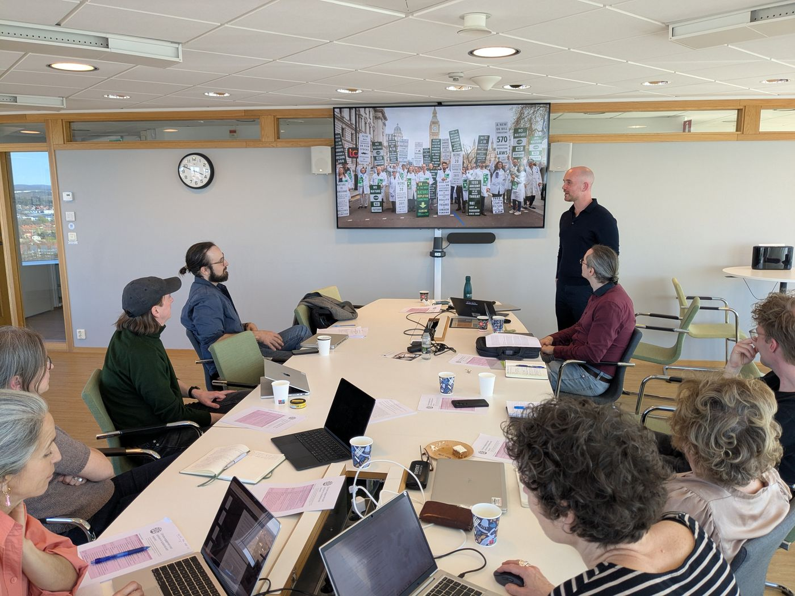
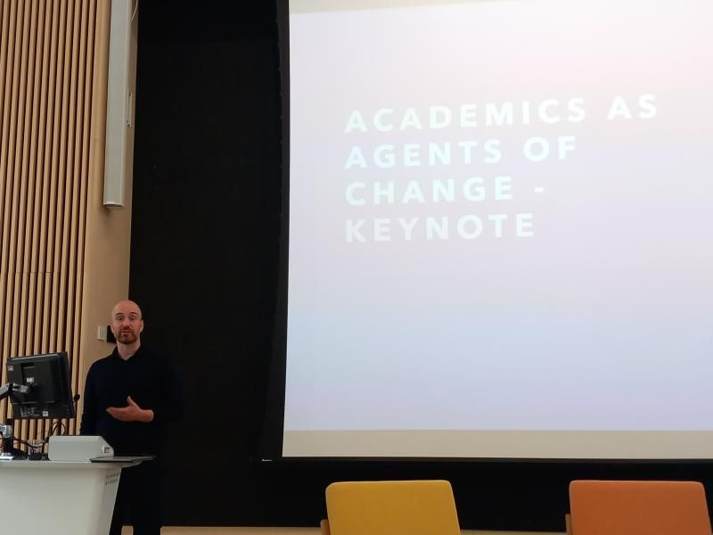
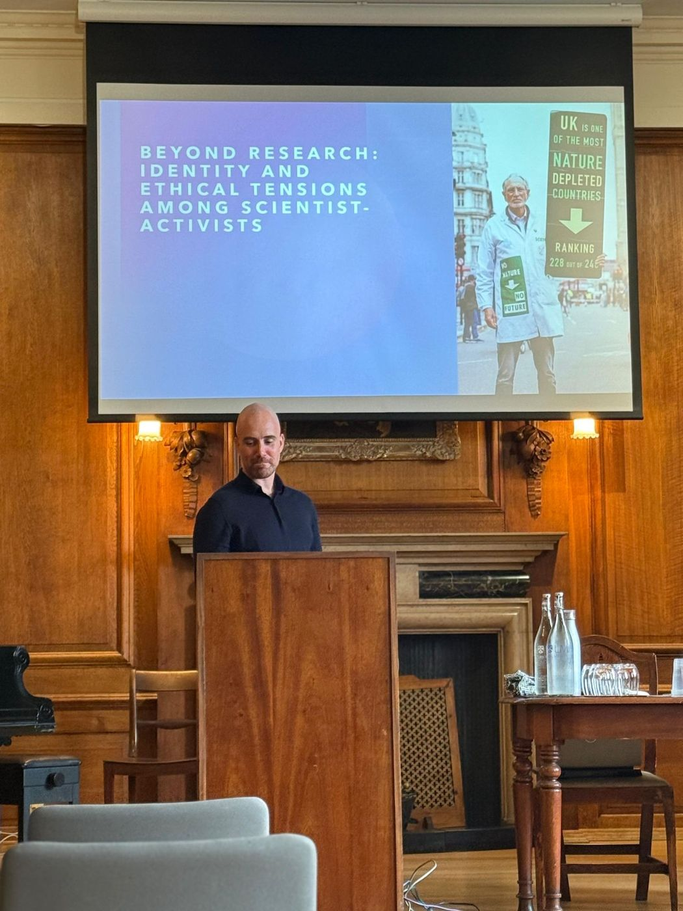
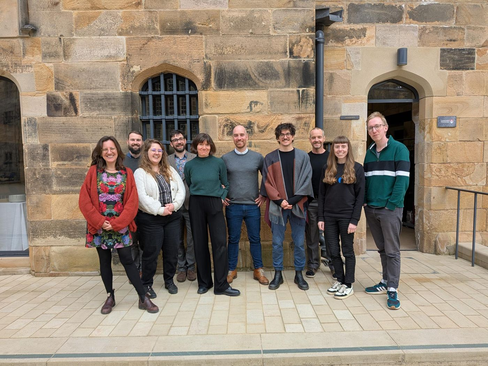
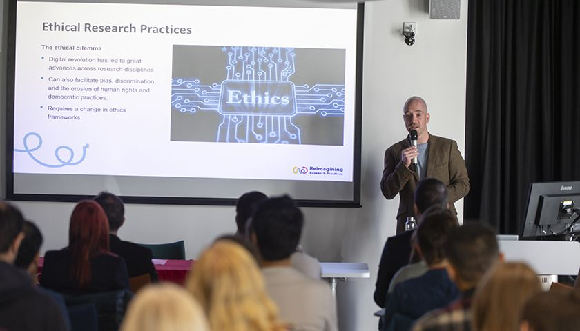
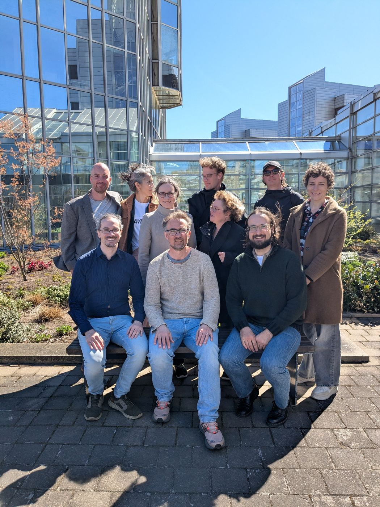

::: gallery
{group="talks" fig-alt="Samuel presenting to a seminar group seated around a long table"}

{group="talks" fig-alt="Samuel speaking beside a screen showing the keynote title"}

{group="talks" fig-alt="Samuel at a lectern in a wood-panelled hall, with a slide titled Beyond Research"}

{group="talks" fig-alt="Workshop participants standing in front of a sandstone building"}

{group="talks" fig-alt="Samuel presenting a slide on ethical research practices to a seated audience"}

{group="talks" fig-alt="Workshop participants outside a glass-fronted university building"}
:::

## Talks

<!-- Talks are listed from data/talks.yml. -->

::: {#talks}
:::

## Media and podcasts

- Guest, *Transforming Tomorrow* podcast. "When Scientists Become Activists". Season 3, Episode 30, 2026. [Listen](https://pod.co/transforming-tomorrow/when-scientists-become-activists)
- Panellist, *Scientists, Advocacy, and Public Trust* (Newswise, 2025). Invited expert on academic advocacy, alongside panellists from MIT, Caltech, and the Association of American Universities. [Watch](https://vimeo.com/1124387582)
- Guest, *This is Lancaster: Global research tales from the North of England* podcast. "Reimagining Research Culture: Universities' response to the climate crisis". [Listen](https://open.spotify.com/episode/5UVYguIc4k4FgydqQecWoD)
- Research footage contributed to the documentaries *#ClimateScam?* (Cornwall Climate Care, 2024), *Plan Z: From Lab Coats to Handcuffs* (Morozov & Jones, 2024), and *Climate Carnage: Whose Job Is It to Save the Planet* (The Guardian, 2022).

## Workshops and public engagement

- Designer, organiser, and facilitator, *Cuppa Conundrums: Ethics in Practice* (Lancaster University, 2024–26). Interdisciplinary workshops on climate responsibility, AI, and research ethics. [Podcast](https://open.spotify.com/show/3dineWPW6jNZfQMZhnfOtb)
- Designer, organiser, and facilitator, *Exploring Climate Action in Higher Education* (Lancaster University and Wellcome Trust, 2024–25). Cross-institutional workshops. [Summary](https://osf.io/tmbqa/overview)
- Chair, *What Role Can Social Science Play in the Climate Emergency?* (2022). Public dialogue with Dr Gail Bradbrook (Extinction Rebellion co-founder), Prof Stellan Vinthagen, and Dr Sara Vestergren.
