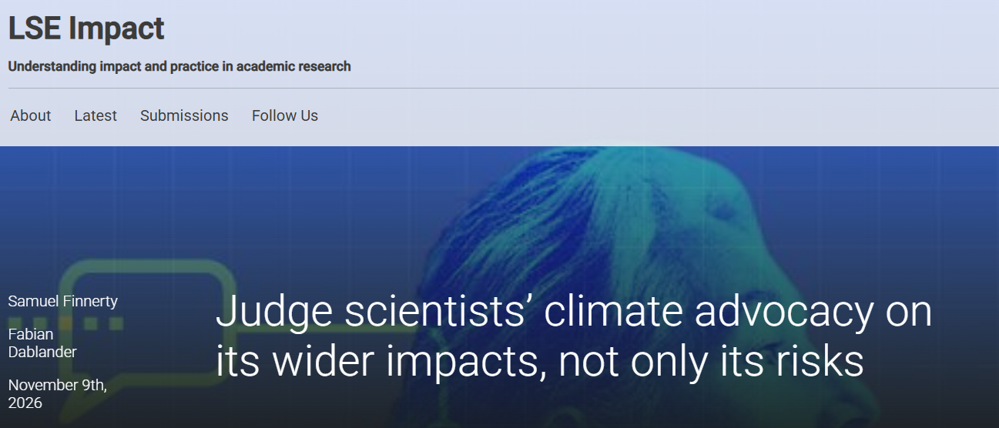

-   Finnerty, S., & Dablander, F. [Judge scientists' climate advocacy on its wider impacts, not only its risks](https://blogs.lse.ac.uk/impactofsocialsciences/2026/11/09/judge-scientists-climate-advocacy-on-its-wider-impacts-not-only-its-risks/). *LSE Impact Blog*, 2026.

    [{.nolightbox width="420px" fig-alt="Screenshot of the article on the LSE Impact Blog"}](https://blogs.lse.ac.uk/impactofsocialsciences/2026/11/09/judge-scientists-climate-advocacy-on-its-wider-impacts-not-only-its-risks/)
    
-   Finnerty, S. [How climate scientists balance the tension between research and public protest: new study](https://theconversation.com/how-climate-scientists-balance-the-tension-between-research-and-public-protest-new-study-274916). *The Conversation*, 2026.
-   Finnerty, S. [Technological optimism, climate action, and how scientists frame solutions](https://www.linkedin.com/pulse/technological-optimism-climate-action-how-scientists-frame-finnerty-s4pse/). LinkedIn, 2025.
-   Finnerty, S. [Behind the paper: 'Between Two Worlds: The Scientist's Dilemma in Climate Activism'](https://communities.springernature.com/posts/between-two-worlds-the-scientist-s-dilemma-in-climate-activism). *Springer Nature Research Communities*, 2024.
-   Finnerty, S. [Responding to the climate crisis: Opportunities and challenges around activism](https://www.bps.org.uk/psychologist/responding-climate-crisis). *The Psychologist*, 2023.
-   Vestergren, S., Finnerty, S., & Acar, Y. G. [Here's why we need climate protests, even if some think they're annoying](https://theconversation.com/heres-why-we-need-climate-protests-even-if-some-think-theyre-annoying-172191). *The Conversation*, 2021.

